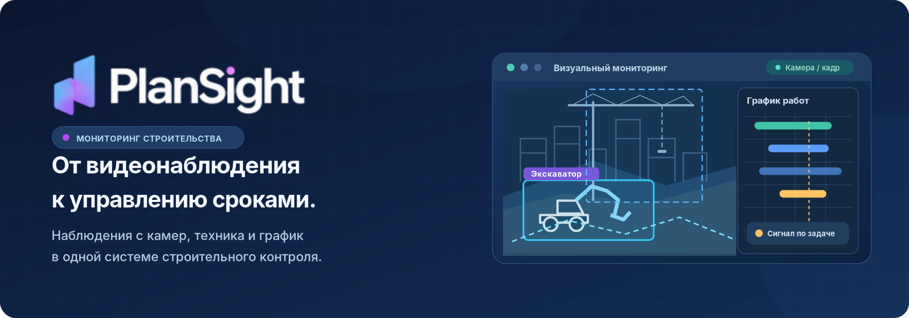
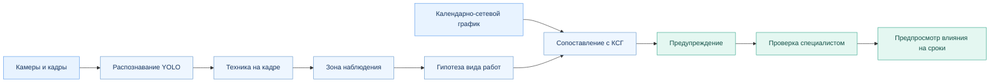
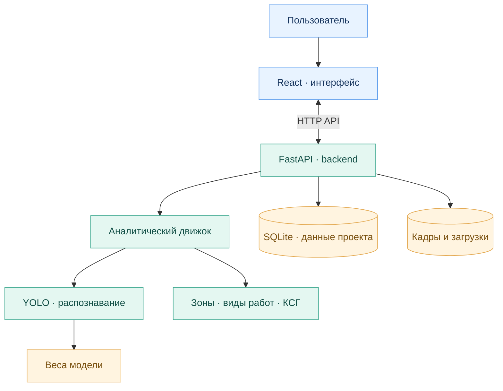

<div align="center">
  <a href="https://plansight.ru" title="Сайт PlanSight">
    
  </a>

  <p><strong>Интеллектуальный мониторинг строительства с привязкой к календарному графику.</strong></p>
  <p>От видеонаблюдения — к управленческим приоритетам: <strong>кадр, техника, задача графика, риск, доказательства и решение.</strong></p>

  <p>
    <a href="http://plansight.ru"></a>
    <a href="#быстрый-старт"></a>
    <a href="docs/README.md"></a>
  </p>
  <p>
    
    
    
    
    
  </p>
</div>

---

## От видеопотока — к управленческому решению

**Камера показывает, что происходит на площадке. Календарно-сетевой график (КСГ) показывает, что должно происходить. PlanSight связывает эти два источника информации.**

Система объединяет компьютерное зрение, пространственный контекст и строительный график, чтобы превращать отдельные наблюдения в структурированные предупреждения для эксперта и руководителя проекта.

| Вопрос руководителя | Как помогает PlanSight |
| :--- | :--- |
| **Что происходит на площадке?** | Выделяет строительную технику на изображениях с помощью YOLO. |
| **Где именно?** | Рассматривает наблюдение в контексте зоны строительной площадки. |
| **К каким работам это относится?** | Формирует гипотезу вида работ и сопоставляет её с задачами КСГ. |
| **На что обратить внимание?** | Создаёт предупреждение с контекстом для проверки специалистом. |
| **Как это связано со сроками?** | Предусматривает предварительную оценку влияния на график при наличии необходимых данных о зависимостях работ. |

**Целевая аудитория:** заказчики строительства, технические заказчики, генподрядчики и команды управления строительными проектами.

## Как это работает



> [!IMPORTANT]
> **PlanSight не подменяет решение инженера.** Компьютерное зрение фиксирует наблюдение, алгоритм формирует связь с работами, а эксперт проверяет предупреждение и принимает решение с учётом материалов проекта.

### Что получает пользователь

| 01 — Наблюдение | 02 — Контекст | 03 — Действие |
| :--- | :--- | :--- |
| Изображение, обнаруженная техника и зона анализа | Связанная задача графика, основание предупреждения, статус сопоставления | Проверка экспертом и предварительная оценка влияния на сроки |

## Модель и данные в цифрах

| 21 тыс. | 25 | 0,63 | 76,9% | 57,7% |
| :---: | :---: | :---: | :---: | :---: |
| Изображений в обучающей выборке | Классов техники | F1-score | Precision | Recall |

**Шаг наблюдения: каждые 20 минут.** Модуль распознавания — **YOLO11**, обученный на строительных объектах: экскаваторы, краны, самосвалы, бетоновозы и другая техника.

<sub>Подробности модели и воспроизводимых проверок: <a href="docs/CV_MODEL.md">CV_MODEL.md</a>.</sub>

## Возможности платформы

- **Компьютерное зрение:** распознавание строительной техники на кадрах с использованием YOLO и настраиваемых весов модели.
- **Привязка к площадке:** сопоставление наблюдений с зонами и гипотезами выполняемых работ.
- **Связь с КСГ:** поиск релевантных задач строительного графика и формирование предупреждений.
- **Экспертная проверка:** отдельный этап принятия решения по предупреждению.
- **Аналитика сроков:** предварительный просмотр потенциального влияния на график, когда доступна необходимая сеть зависимостей КСГ.
- **Развёртывание:** локальный запуск или контейнерная сборка с Docker.

<details>
<summary><strong>Посмотреть архитектуру платформы</strong></summary>

<br />



Дополнительные материалы: [архитектура](docs/ARCHITECTURE.md) · [бизнес-логика](docs/BUSINESS_LOGIC.md) · [модель компьютерного зрения](docs/CV_MODEL.md).

</details>

## Технологии

| Уровень | Технологии | Роль |
| :--- | :--- | :--- |
| Пользовательский интерфейс | **React**, Vite | Работа с проектами, графиком и предупреждениями |
| Сервер и аналитика | **Python 3.12+**, **FastAPI** | API и аналитический движок |
| Компьютерное зрение | **YOLO**, пользовательские веса | Обнаружение строительной техники |
| Данные | **SQLite**, локальные кадры и загрузки | Данные проектов и результаты наблюдений |
| Развёртывание | **Docker Compose** | Контейнерный запуск и обновление |
| Режим работы с ИИ | **template / Ollama** | Выбор режима через конфигурацию |

<a id="быстрый-старт"></a>
## Быстрый старт

**Для контейнерного запуска** нужны Docker Engine, Docker Compose и файл весов модели `models/yolo11s_combined_v1_best.pt`.

```bash
docker compose up -d --build
```

После запуска:

| Компонент | Локальный адрес |
| :--- | :--- |
| Интерфейс | <http://localhost:5175> |
| API | <http://localhost:8010> |
| Проверка доступности API | <http://localhost:8010/health> |

```bash
curl http://localhost:8010/health
```

> [!NOTE]
> Согласно базовой конфигурации, при первом запуске Docker может использовать предзагруженный набор `product_demo/`, если рабочая БД отсутствует. Повторный `docker compose up` не пересоздаёт существующую базу. Детали: [развёртывание](docs/DEPLOYMENT.md).

<details>
<summary><strong>Локальный запуск без Docker · Windows / PowerShell</strong></summary>

<br />

**Терминал 1 — сервер:**

```powershell
cd PlanSight\backend
python -m venv .venv
.\.venv\Scripts\Activate.ps1
pip install -r requirements.txt
$env:PLANSIGHT_DATABASE_PATH="..\data\plansight.db"
python -m uvicorn app.main:app --host 127.0.0.1 --port 8010
```

**Терминал 2 — интерфейс:**

```powershell
cd PlanSight\frontend
npm ci
npm run dev
```

Требования: Python 3.12+, Node.js 22+. Поддерживаемые системы по исходной документации: Windows / Linux / macOS.

Frontend обращается к API через прокси Vite. Локальный режим на `localStorage` включается только при явном `VITE_DEMO_MODE=true`.

</details>

<details>
<summary><strong>Веса модели, данные и предзагруженный сценарий</strong></summary>

<br />

**Веса YOLO:** положите файл модели по пути из `backend/config.yaml` → `detector.model` либо настройте `model_fallback`. Описание: [docs/CV_MODEL.md](docs/CV_MODEL.md).

**Рабочая БД:** `data/plansight.db`. Тесты используют временную копию, чтобы не изменять рабочую БД.

**Установка подготовленных данных в рабочий каталог:**

```powershell
cd backend
.\.venv\Scripts\python.exe scripts\install_product_demo.py --force
```

**Упаковка данных для развёртывания:**

```powershell
cd backend
.\.venv\Scripts\python.exe scripts\pack_product_demo.py --src-data ..\data --out ..\product_demo
```

Подготовленный пример проекта: [ЖК «Строгино 360»](docs/DEMO_STROGINO_360.md).

</details>

<details>
<summary><strong>Развёртывание на сервере и проверка релиза</strong></summary>

<br />

**Запуск с явной конфигурацией предзагруженного набора:**

```bash
docker compose -f docker-compose.yml -f compose.product-demo.yml up -d --build
```

**Linux-сервер (скрипт развёртывания):**

```bash
bash deploy/up-demo.sh
```

**Проверка перед релизом (из `backend/`):**

```bash
python scripts/release_preflight.py --with-tests
```

В серверную сборку входят: `backend/`, `frontend/`, `product_demo/`, `models/`, `deploy/`, `docker-compose.yml`, `.dockerignore`, `README.md`; также по необходимости `docs/`, `compose.product-demo.yml`, `demo/stills/`.

Не переносить в релиз как исходники: `data/`, `backend/.venv/`, `frontend/node_modules/`, `frontend/dist/`, `.pytest_cache/`.

Подробнее: [docs/DEPLOYMENT.md](docs/DEPLOYMENT.md).

</details>

## Структура репозитория

```text
PlanSight/
├── frontend/             # React-интерфейс
├── backend/              # FastAPI и аналитический движок
├── models/               # Веса YOLO
├── data/                 # Локальная БД и кадры; не коммитится
├── product_demo/         # Подготовленная БД и кадры
├── docs/                 # Документация
│   └── assets/           # Обложка и официальный логотип PlanSight
├── deploy/               # Сценарии развёртывания
├── docker-compose.yml
└── README.md
```

## Документация

| Документ | Что внутри |
| :--- | :--- |
| [Общее описание](docs/README.md) | Продукт и навигация по документации |
| [Архитектура](docs/ARCHITECTURE.md) | Компоненты и взаимодействия |
| [Бизнес-логика](docs/BUSINESS_LOGIC.md) | Порядок обработки наблюдений и предупреждений |
| [Компьютерное зрение](docs/CV_MODEL.md) | Модель YOLO, веса и настройки |
| [Тестирование](docs/TESTING.md) | Запуск и подход к проверкам |
| [Развёртывание](docs/DEPLOYMENT.md) | Запуск на сервере и эксплуатация |
| [Ограничения](docs/KNOWN_LIMITATIONS.md) | Известные ограничения текущей конфигурации |

<details>
<summary><strong>Конфигурация, резервные копии и диагностика</strong></summary>

<br />

| Переменная окружения | Назначение |
| :--- | :--- |
| `PLANSIGHT_DATABASE_PATH` | Путь к SQLite |
| `PLANSIGHT_AI_MODE` | `template` (по умолчанию) либо `ollama` |

**Резервное копирование:** сохранить `data/plansight.db`, `data/frames/` и `data/uploads/`.

**Если что-то не работает:**

- Нет детекций → проверить путь к весам, SHA модели, параметр `imgsz` и качество кадра; см. [CV_MODEL.md](docs/CV_MODEL.md).
- Недоступна предварительная оценка влияния на срок → проверить полноту сети зависимостей КСГ.
- Пустой портфель → проверить предзагруженные данные и путь к базе SQLite.

Полный список ограничений: [docs/KNOWN_LIMITATIONS.md](docs/KNOWN_LIMITATIONS.md).

</details>

---

<div align="center">
  <h3>PlanSight — от наблюдения к проверяемому решению</h3>
  <p>Компьютерное зрение × строительный график × экспертная проверка</p>
  <p><a href="http://plansight.ru"><strong>plansight.ru ↗</strong></a> · <a href="https://disk.yandex.ru/d/el1a-EikvakXhg">Документация</a> · <a href="#быстрый-старт">Запустить проект</a></p>
  <p><sub>Доступ к сайту может быть ограничен для подключений за пределами России.</sub></p>
</div>
